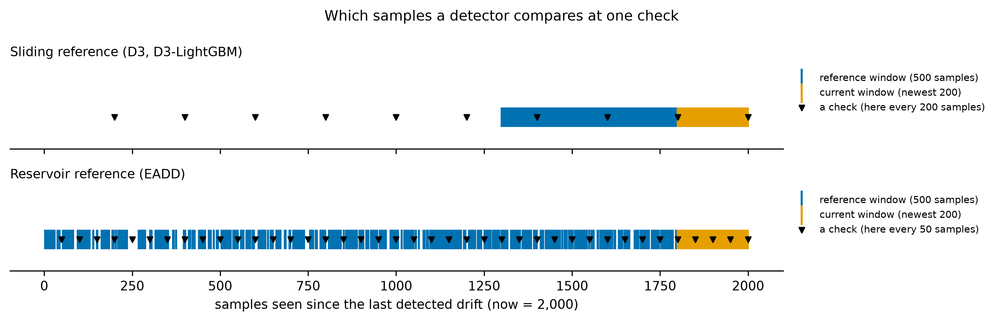
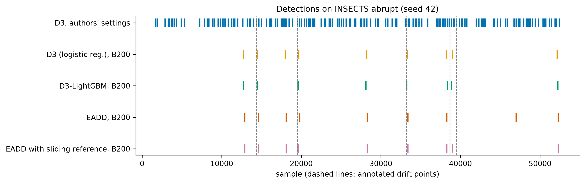
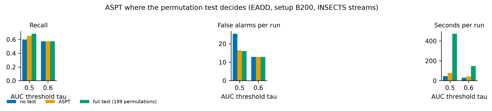

# Is EADD better than D3? A fair comparison

Nusrat Begum, M.Sc. thesis "Feature Drift Detection Techniques via Adversarial Validation", Mahidol University. Report for Asst. Prof. Thanapon Noraset, 15 November 2026.

This report answers the questions from our meeting of 10 November 2026. It is written so that anyone with basic machine-learning knowledge can follow it. Section 1 explains the ideas, Section 4 gives the answers, and Section 6 shows how to run everything yourself.

---

## Contents

1. [The ideas in two minutes](#1-the-ideas-in-two-minutes)
2. [Where the thesis stands today](#2-where-the-thesis-stands-today)
3. [What we ran](#3-what-we-ran)
4. [Results](#4-results)
5. [Answers to the 10 November questions](#5-answers-to-the-10-november-questions)
6. [How to run it yourself](#6-how-to-run-it-yourself)
7. [How we know the code is correct](#7-how-we-know-the-code-is-correct)
8. [Limitations](#8-limitations)
9. [Files and glossary](#9-files-and-glossary)

---

## 1. The ideas in two minutes

### Drift and how D3 and EADD find it

A data stream is a sequence of samples arriving one at a time (here, sensor readings of insects, 33 features each). **Feature drift** means the distribution of the features changes at some point, for example because the temperature in the insect experiment changes.

Both detectors in this report use the same trick, called a **classifier two-sample test**:

1. Keep two groups of samples: a **reference window** (what the data looked like before) and a **current window** (the newest samples).
2. Label the reference samples 0 and the current samples 1, and train a classifier to tell them apart.
3. Measure how well it does with the **AUC** (area under the ROC curve). An AUC near 0.5 means the classifier cannot tell the groups apart, so nothing has changed. An AUC near 1 means the groups are clearly different, so there is drift.
4. If the AUC is above a **threshold τ** (0.7 here), raise a drift alarm.

The AUC is measured on held-out data with **k-fold cross-validation**: train on part of the samples, test on the rest, repeat k times.

### The two detectors

| | **D3** | **EADD** (this thesis) |
|---|---|---|
| Published | Gözüaçık et al., CIKM 2019 ([paper](https://doi.org/10.1145/3357384.3358144), [authors' code](https://github.com/ogozuacik/d3-discriminative-drift-detector-concept-drift)) | JCSSE 2026 ([IEEE Xplore](https://ieeexplore.ieee.org/document/11596765)); code: [`detectors/eadd.py`](../../detectors/eadd.py) |
| Classifier | logistic regression | LightGBM (gradient-boosted trees) |
| Reference window | **sliding**: the 500 samples just before the current window | **reservoir**: 500 samples drawn at random from everything seen since the last drift |
| Decision | AUC above τ | AUC above τ, then a permutation test (**ASPT**) must confirm it |

**D3-LightGBM** is D3 with LightGBM instead of logistic regression ([`detectors/d3_lightgbm.py`](../../detectors/d3_lightgbm.py)). You asked for it on 12 October so that D3 and EADD use the same classifier.

### Sliding vs reservoir reference: the key difference



*Figure 0. At one moment (2,000 samples after the last drift), the orange block is the current window: the newest 200 samples, the same for both. The blue marks are the reference window.*
- **Sliding (D3).** The reference is the 500 samples right before the current window, so it moves forward with the stream.
- **Reservoir (EADD).** The reference is 500 samples spread over the whole period since the last drift, so it remembers older data.
- **Checks (triangles).** D3 checks every 200 samples; the thesis EADD checks every 50.

Why it matters:
- **Slow drift.** A sliding reference moves along with a slow change, so the two windows always look alike and the drift is never seen. The reservoir still holds samples from before the change, so it can see it.
- **A stream that keeps changing slightly.** The reservoir also sees those small, harmless changes, which can cause extra alarms.

### ASPT, the permutation test

When the AUC passes τ, EADD asks: *could an AUC this high happen by chance?* It shuffles the 0/1 labels many times, retrains, and checks how often the shuffled AUC is as high as the real one. That fraction is a **p-value**: the alarm is kept only if it is below 0.05.

A full permutation test uses 199 shuffles. **ASPT** (adaptive sequential permutation test) stops early once the answer is clear: after as few as 20 shuffles when the drift is obvious.

### How we score a detector

A stream with **known drift points** lets us check every alarm.

| Measure | Meaning | Better |
|---|---|---|
| **Recall** | Share of the true drift points that got an alarm within 500 samples after them | higher |
| **MTD** (mean time to detection) | How many samples after the drift the alarm came, on average; a missed drift counts as 500 | lower |
| **False alarms** | Alarms that match no drift point, per run | lower |

On the synthetic gradual and incremental streams the change itself takes 1,000 samples, so an alarm counts if it comes within 1,500 samples.

---

## 2. Where the thesis stands today

The thesis tests three hypotheses ([thesis](https://github.com/NusratBegum/Nusrat-Thesis-Mahidol-University), Chapter 4):

| Hypothesis | Claim | Result in the thesis (3 Nov, revised 15 Nov) |
|---|---|---|
| **H1** | EADD has higher recall and lower MTD than D3-LightGBM | **Not supported**: recall 0.50 vs 0.65, MTD 302 vs 279 |
| **H2** | EADD has fewer false alarms than D3-LightGBM | **Not supported**: 8.9 vs 5.6 per run |
| **H3** | ASPT gives the same detections as a full permutation test and is faster | **Supported, with a gap**: it was tested only at τ = 0.7, where the test never rejected an alarm |

On 10 November you asked:
- (a) How does D3 do with the settings its authors used?
- (b) How do EADD and D3-LightGBM compare when everything else is identical?
- (c) Is ASPT or something else responsible for the results?
- (d) A clear setup that you can run yourself.

This report does all four. None of these new results is in the thesis yet; that waits for your decision (Section 5).

---

## 3. What we ran

### Data

| Stream | Type | Length | Features | Drift points | Source |
|---|---|---|---|---|---|
| INSECTS abrupt (balanced) | real | 52,848 | 33 | 5 | [Souza et al. 2020](https://doi.org/10.1007/s10618-020-00698-5), [USP repository](https://sites.google.com/view/uspdsrepository) |
| INSECTS gradual (balanced) | real | 24,150 | 33 | 1 | same |
| INSECTS incremental-abrupt (balanced) | real | 79,986 | 33 | 2 | same |
| INSECTS incremental-reoccurring (balanced) | real | 79,986 | 33 | 2 | same |
| Synthetic abrupt | synthetic | 20,000 | 10 | 3 | [`synthetic_streams.py`](../../synthetic_streams.py) |
| Synthetic gradual | synthetic | 20,000 | 10 | 3 | same |
| Synthetic incremental | synthetic | 20,000 | 10 | 3 | same |
| Synthetic recurring | synthetic | 20,000 | 10 | 3 | same |
| Synthetic, no drift | synthetic | 20,000 | 10 | 0 (counts false alarms only) | same |

**How the synthetic streams are built.**
- **Features.** 10 features drawn from a normal distribution. At samples 5,000, 10,000 and 15,000, three of the features shift by one standard deviation.
- **Abrupt:** the shift happens at once.
- **Gradual:** over 1,000 samples, more and more samples come from the new distribution.
- **Incremental:** the mean moves step by step over 1,000 samples.
- **Recurring:** the shift switches on and off.
- **No drift:** a stream with no shift at all, used only to count false alarms.
- **Seeds.** Each of the 5 seeds (42, 142, 242, 342, 442) draws a new synthetic stream. The real streams are fixed files, so for them the seed only changes the classifiers' randomness.

### Experiment groups

Every variant ran on all 9 streams × 5 seeds. In total there were 1,645 runs, on your server (10 cores, about 2.5 hours).

| Group | Question | What runs |
|---|---|---|
| **A** | (a) Each detector with its own settings | D3 with its authors' settings; D3-LightGBM and EADD as in the thesis |
| **B** | (b) Identical setup | D3, D3-LightGBM and EADD with the same windows (500 reference, 200 current), the same τ = 0.7, the same seeds, the same check interval and the same folds. Two versions: **B200** = check every 200 samples with 2-fold CV (D3's choice); **B50** = every 50 with 5-fold CV (EADD's choice) |
| **C** | (c) Which part of EADD matters | EADD with each part switched on or off: sliding vs reservoir reference, with or without ASPT |
| **D** | (c) Does ASPT match the full test where it matters | EADD at τ = 0.5 and 0.6, where many alarms reach the test: ASPT vs full test vs no test |
| **E** | Threshold check for D3 | D3 and D3-LightGBM at τ = 0.3 to 0.6 |
| **F** | Robustness | Group B again, with each seed starting the stream at a different sample (0, 40, 80, 120, 160) |

**D3 with its authors' settings** (group A), from their code (`python D3.py elec.csv 100 0.1 0.7`):
- logistic regression;
- a reference of 100 samples and a current window of 10;
- a check every 10 samples, τ = 0.7, 2-fold CV.

**The JCSSE paper did not use these settings.** It ran D3 with windows of 100/50 in one experiment and 300/120 in another, while describing the windows as "matched".

**One known flaw in the thesis EADD is tested too.** A new sample can sit in the reservoir and in the current window at the same moment, so the classifier sees it with both labels. "EADD, no overlap" fixes this. It is an option in the code, `reservoir_after_current=True`; the default keeps the thesis behaviour.

---

## 4. Results

### 4.1 Each detector with its own settings (group A)

| | INSECTS: recall | MTD | false alarms/run | Synthetic: recall | MTD | false alarms/run | No-drift stream: false alarms/run |
|---|---|---|---|---|---|---|---|
| D3, authors' settings | 0.91 | 156 | **169.7** | 0.93 | 257 | **63.5** | **70.6** |
| D3-LightGBM (thesis) | 0.65 | 279 | 5.6 | 0.47 | 872 | 0.0 | 0.0 |
| EADD (thesis) | 0.50 | 302 | 8.9 | 1.00 | 522 | 0.0 | 0.0 |

With its authors' settings D3 compares windows of only 100 and 10 samples, so it raises an alarm about every 300 samples. It even raises 71 alarms on a stream with no drift at all. Its high recall is a side effect of raising alarms almost constantly. A fair comparison therefore needs the same larger windows for every detector: that is group B.



*Figure 4. Every vertical mark is one alarm; the dashed lines are the five true drift points of INSECTS abrupt (seed 42). D3 with its authors' settings (top row) fires all the time; the others fire near the drift points and a few times in between.*

### 4.2 Identical setup (group B)


*Figure 1. Top row: real INSECTS streams; bottom row: synthetic streams. "A" rows use each detector's own settings, "B200" and "B50" rows the identical setups.*

| Setup | Detector | INSECTS: recall | MTD | false alarms/run | Synthetic: recall | MTD | false alarms/run |
|---|---|---|---|---|---|---|---|
| B200 | D3 (logistic regression) | 0.67 | 295 | 5.9 | 0.50 | 846 | 0.0 |
| B200 | D3-LightGBM | 0.65 | 279 | 5.6 | 0.47 | 872 | 0.0 |
| B200 | EADD | 0.60 | 292 | 7.9 | **1.00** | **596** | 0.0 |
| B50 | D3 (logistic regression) | 0.70 | 263 | 8.7 | 0.52 | 811 | 0.0 |
| B50 | D3-LightGBM | 0.70 | 253 | 9.8 | 0.50 | 831 | 0.0 |
| B50 | EADD | 0.50 | 302 | 8.9 | **1.00** | **522** | 0.0 |

**What the tests say** (one-sided Mann-Whitney and paired Wilcoxon, 20 runs each, in [`tests.csv`](tests.csv)):
- **On INSECTS, EADD never has a higher recall or a lower MTD than either D3** (recall p > 0.7 everywhere). In B200 both D3 versions also raise fewer false alarms. The one point in EADD's favour: in B50 it raised fewer false alarms than D3-LightGBM (8.9 vs 9.8, Wilcoxon p = 0.027).
- **On the synthetic streams, EADD finds every drift point and D3 finds about half** (p ≤ 0.002 in all four comparisons), with a shorter delay and no false alarms on either side. The half that D3 misses are the gradual and incremental drifts: it misses almost all of them (Figure 5).
- **Logistic regression and LightGBM give almost the same D3.** The classifier is not what separates EADD from D3.


*Figure 5. Synthetic gradual stream (seed 42): three slow drifts at 5,000, 10,000 and 15,000. D3 (logistic regression and LightGBM) never fires, EADD fires once per drift, and D3 with its authors' settings fires all the time.*

### 4.3 Which part of EADD matters (group C)


*Figure 2. EADD with one part changed at a time, in setup B200.*

| Setup B200, τ = 0.7 | INSECTS: recall | MTD | false alarms/run | Synthetic: recall | MTD |
|---|---|---|---|---|---|
| Sliding reference, no test | 0.85 | 207 | 5.1 | 0.50 | 883 |
| Sliding reference + ASPT | 0.85 | 207 | 5.1 | 0.50 | 883 |
| Reservoir, no test | 0.60 | 292 | 7.9 | 1.00 | 596 |
| Reservoir + ASPT (= EADD) | 0.60 | 292 | 7.9 | 1.00 | 596 |
| Reservoir without overlap + ASPT | 0.60 | 340 | 11.4 | 1.00 | 559 |

Reading the table:
- **Adding ASPT changes nothing at τ = 0.7.** At that threshold every alarm that reaches the test is confirmed, so ASPT cannot be the reason H1 and H2 failed.
- **The reference window decides everything.** The reservoir is what lets EADD find the slow synthetic drifts. It is also what makes EADD worse on INSECTS, where the data keep changing slowly between the annotated drift points and the reservoir notices those changes too.
- **Fixing the overlap makes EADD more sensitive.** On INSECTS that means more false alarms. The overlap had been hiding some drift by lowering the AUC.
- **A caution about the first row.** "Sliding reference, no test" has the same settings as D3-LightGBM in B200, but reaches recall 0.85 against 0.65. The two programs differ in small details: what they do right after an alarm, and exactly which samples fall on a check. Group F (Section 4.5) shows that such details move D3's recall by as much as 0.17. So 0.85 is not evidence that EADD with a sliding reference beats D3.

### 4.4 Does ASPT match the full test where it matters? (group D)



*Figure 3. EADD in setup B200 on INSECTS at τ = 0.5 and 0.6.*

| EADD, B200, INSECTS | Recall | MTD | False alarms/run | Seconds per run |
|---|---|---|---|---|
| τ = 0.5, no test | 0.60 | 315 | 25.5 | 46 |
| τ = 0.5, **ASPT** | 0.66 | 307 | 16.5 | 78 |
| τ = 0.5, full test (199 shuffles) | 0.69 | 287 | 16.1 | 474 |
| τ = 0.6, all three | 0.58 | 341 | 12.9 | 30 / 42 / 148 |

What this shows:
- **τ = 0.5 is where the test actually rejects many alarms.** It is the evidence the thesis was missing for H3.
- **ASPT and the full test give no significant difference** in recall, MTD or false alarms (two-sided Wilcoxon p = 0.18, 0.34, 0.14).
- **ASPT is 6.1 times faster,** and faster in 20 of 20 runs.
- **Both tests remove a third of the false alarms of having no test** (p < 0.001).
- **On the stream without drift:** ASPT raises 1.2 false alarms per run, the full test 1.0, and no test 5.6.

### 4.5 Two robustness checks (groups E and F)

- **A lower threshold does not rescue D3.** At τ = 0.3 to 0.5 it raises 87 to 115 false alarms per run on INSECTS, and 27 to 39 on the stream without drift.
- **Where the checks fall matters.** When each seed starts the stream at a different sample, recall changes:

  | | Start at sample 0 | Different start per seed |
  |---|---|---|
  | D3-LightGBM | 0.65 | 0.82 |
  | D3 (logistic regression) | 0.67 | 0.80 |
  | EADD | 0.60 | 0.68 |

  EADD still comes last, but every recall difference on INSECTS partly depends on where the checks fall relative to the annotated drift points.

---

## 5. Answers to the 10 November questions

**(a) D3 with its authors' settings vs EADD.** With its authors' settings D3 raises an alarm every few hundred samples: 170 false alarms per run on INSECTS and 71 on a stream with no drift. Its recall is high only because it alarms almost constantly. The JCSSE paper did not use these settings; it used windows of 100/50 and 300/120 while calling them "matched", and this should be corrected after the defense.

**(b) Identical setup.** On the real INSECTS streams EADD does not beat D3, with either classifier, so H1 and H2 are still not supported. On synthetic streams with known drift points EADD finds every drift and D3 only about half (p ≤ 0.002), with no false alarms on either side.

**(c) Is it ASPT or something else?** It is not ASPT: at τ = 0.7 it changes no detection. The part that decides the result is the **reservoir reference window**. It helps with slow drift (synthetic) and hurts on streams that keep changing slightly (INSECTS). The classifier (logistic regression vs LightGBM) barely matters. ASPT's real contribution shows at τ = 0.5: the same decisions as a full permutation test at one sixth of the cost.

**Possible directions (for your decision):**

| Option | What changes | Pros | Cons |
|---|---|---|---|
| 1. Keep H1-H3 as stated | Report both kinds of data: H1/H2 not supported on INSECTS, H1 supported on synthetic data, H3 supported with the new τ = 0.5 evidence | Honest; no new design | The main claim holds only on synthetic data |
| 2. Revise H1/H2 | Claim what the data show: "a long-memory reference finds slow drifts that a sliding reference misses", tested on synthetic data and INSECTS | Matches the evidence; explains why EADD loses on INSECTS | Changes the hypotheses approved in the proposal |
| 3. Fix EADD | A new design, for example an overlap-free reservoir that also slides | Could improve on both kinds of data | Chosen after seeing these results, so it needs new held-out streams to be a fair test |

---

## 6. How to run it yourself

Everything runs from the code repository [NusratBegum/unsupervised-concept-drift-detection](https://github.com/NusratBegum/unsupervised-concept-drift-detection), on a laptop or on your server. It needs Python 3.13 and [uv](https://docs.astral.sh/uv/).

**Step 1. Install** (about 2 minutes):

```bash
git clone https://github.com/NusratBegum/unsupervised-concept-drift-detection.git
cd unsupervised-concept-drift-detection
uv venv --python 3.13
source .venv/bin/activate
uv pip install -r requirements-lock.txt      # the exact package versions used here
```

**Step 2. Data.** The synthetic streams need nothing. For the real streams, download the INSECTS files from the [USP Data Stream Repository](https://sites.google.com/view/uspdsrepository), copy them to `datasets/files/` and run `python add_headers.py` (details in the README, section "Datasets").

**Step 3. Check the code** (5 seconds):

```bash
python -m pytest -q test/detectors/test_eadd.py test/detectors/test_d3_lightgbm.py test/detectors/test_d3.py
```

**Step 4. Try one run** (about 10 seconds): EADD on the synthetic gradual stream.

```bash
python -c "
from experiment_hypotheses import run_job
from analyze_hypotheses import detection_metrics
r = run_job(dict(part='annotated', dataset='SynthGradual', detector='EADD', seed=42, tau=0.7, test='aspt', freq=200, eadd_kwargs=dict(n_folds=2)))
print('alarms at samples', r['detections'])
print(detection_metrics(r['detections'], r['true_drifts'], 1500))"
```

It prints three alarms, one after each drift point (5,000, 10,000, 15,000), and recall 1.0. Replace `detector='EADD'` by `detector='D3-LightGBM'` and use `eadd_kwargs=dict(n_reference_samples=500, recent_samples_proportion=0.4, step=200, n_folds=2)` to see D3 miss them.

**Step 5. Run everything** (1,645 runs; about 2.5 hours on 10 cores; it can be stopped and restarted, finished runs are skipped):

```bash
taskset -c 0-9 python experiment_comparison.py    # all groups; on Linux taskset limits it to 10 cores
python experiment_comparison.py --list            # list every variant
python experiment_comparison.py --only A B        # only some groups
python analyze_comparison.py                      # tables and tests (1 minute)
python make_comparison_figures.py                 # figures (1 minute)
```

| Script | What it does |
|---|---|
| [`experiment_comparison.py`](../../experiment_comparison.py) | Defines groups A to F and runs them; one line per run in `runs.jsonl` |
| [`analyze_comparison.py`](../../analyze_comparison.py) | Computes recall, MTD, false alarms and the tests from `runs.jsonl` |
| [`make_comparison_figures.py`](../../make_comparison_figures.py) | Draws Figures 0 to 5 |
| [`synthetic_streams.py`](../../synthetic_streams.py) | The five synthetic streams (`python synthetic_streams.py` prints a check) |
| [`experiment_hypotheses.py`](../../experiment_hypotheses.py) | `make_detector` (all detector settings) and `run_job` (feeds a stream to a detector), shared with the thesis experiments |

---

## 7. How we know the code is correct

| Check | Result |
|---|---|
| The thesis results are reproduced | The thesis EADD and D3-LightGBM runs were run again inside this experiment: **40 of 40 runs give exactly the same alarms** as the runs reported in the thesis ([`reproduced.txt`](reproduced.txt)). So the new options added to the code did not change the old behaviour, and the package versions in `requirements-lock.txt` reproduce the thesis. |
| Unit tests | 20 tests pass, including new ones: the D3 check interval, the number of CV folds, and that the overlap-free reservoir never shares a sample with the current window. |
| Behaviour on a stream without drift | Every detector in the identical setup raises 0 false alarms on the no-drift stream at τ = 0.7, as it should. |
| ASPT vs full test | Identical alarms in all 20 runs at τ = 0.6 and 0.7, as expected when the test confirms every alarm. |
| Logistic regression vs LightGBM in D3 | Nearly identical results, as expected for well-separated windows. |
| D3 settings | Taken from the authors' published code, not from memory (Section 3). |
| Thesis numbers | 13 independent reviewers rechecked every number, the method description, the data and the chapters of the thesis on 15 Nov; every finding was checked again by a second reviewer, and 80 confirmed problems were fixed. |

Not yet done: an independent second reviewer has not yet checked the new scripts in this report (`experiment_comparison.py`, `analyze_comparison.py`, `synthetic_streams.py`).

---

## 8. Limitations

- **The real runs are not independent.** The four INSECTS streams are the same files for every seed, so many detectors produce the same alarms in all five seeds. The 20 real runs are closer to 4 independent results than 20. The synthetic streams do not have this problem.
- **The synthetic streams are simple.** Normal distributions, 3 drifting features, shifts of one standard deviation. They show *why* the detectors differ, not how well they do on real data.
- **The matching window shapes every number.** 500 samples, or 1,500 for slow synthetic changes.
- **The analyses were not planned in advance.** Groups C to F were designed after the root-cause analysis of 8 November. Any new hypothesis based on them should be tested on data that was not used to design it.

---

## 9. Files and glossary

**Files in this folder**

| File | Content |
|---|---|
| [`runs.jsonl`](runs.jsonl) | One line per run: the settings, the alarm positions, the runtime |
| [`summary.csv`](summary.csv) | Mean recall, MTD, false alarms, precision and runtime per variant and stream type |
| [`per_stream.csv`](per_stream.csv) | The same per stream |
| [`tests.csv`](tests.csv) | Significance tests of EADD against each D3 in the same setup |
| [`reproduced.txt`](reproduced.txt) | The reproduction check (40 of 40) |
| [`figures/`](figures/) | Figures 0 to 5 as PDF and 300 dpi PNG |
| [`run.log`](run.log) | Log of the server run |

**Glossary**

| Term | Meaning |
|---|---|
| AUC | Area under the ROC curve: 0.5 = the classifier is guessing, 1 = it separates the two windows perfectly |
| C2ST | Classifier two-sample test: train a classifier to tell two samples apart; if it can, they differ |
| Check interval | How many new samples arrive between two checks |
| CV folds | Number of parts in k-fold cross-validation for the AUC |
| Reference / current window | The older samples and the newest samples that are compared |
| Sliding reference | The reference is the block just before the current window and moves with the stream |
| Reservoir reference | The reference is a random sample of everything since the last drift (reservoir sampling, [Vitter 1985](https://doi.org/10.1145/3147.3165)) |
| τ (tau) | AUC threshold above which an alarm is raised |
| Permutation test, p-value | Shuffle the labels many times; the p-value is the share of shuffles that reach the real AUC |
| ASPT | Adaptive sequential permutation test: a permutation test that stops early when the answer is clear |
| Recall, MTD, false alarms | See Section 1 |
| Mann-Whitney, Wilcoxon | Non-parametric tests that compare two groups of runs (Wilcoxon pairs the runs on the same stream and seed) |
