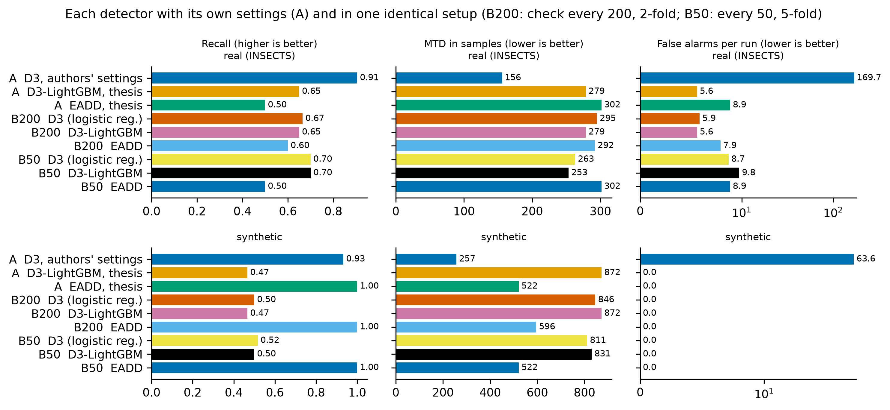
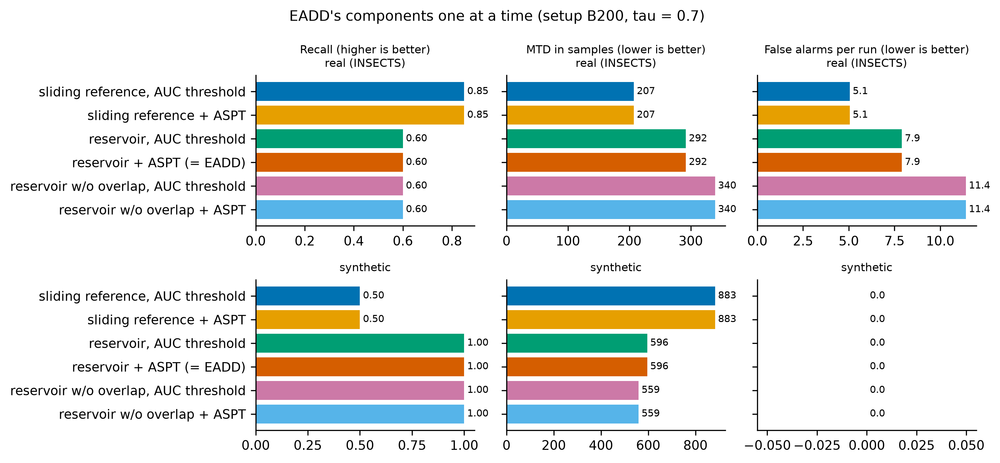
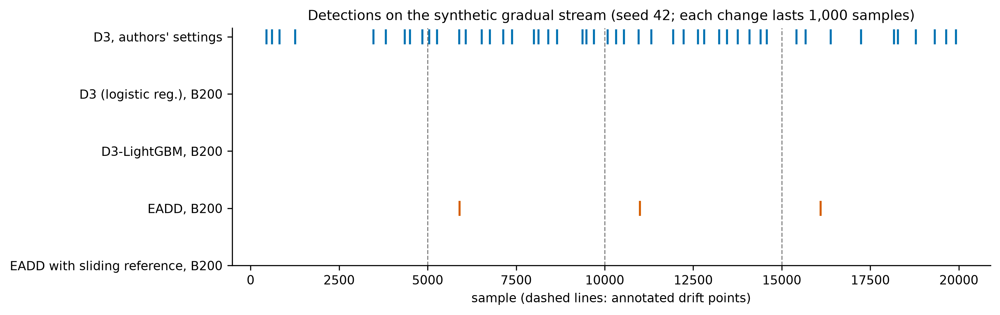

# EADD vs D3: authors' settings, identical setup, and EADD's components

Report for Ajarn Thanapon Noraset, 15 Nov 2026, following the meeting of 10 Nov. All numbers come from `runs.jsonl` in this folder (1,645 runs, all finished without error) through `analyze_comparison.py`; the figures come from `make_comparison_figures.py`.

## 1. What was asked on 10 Nov, and where it is answered

| Question | Answered in |
|---|---|
| (a) D3 with the settings its authors used, against EADD | Section 5.1, group A |
| (b) D3 with LightGBM in the same setup as EADD (same windows, check interval, folds, seeds) | Section 5.2, group B |
| (c) Which component makes EADD better or worse: ASPT or something else | Sections 5.3 and 5.4, groups C and D |
| (d) A clear setup and the commands to run everything | Sections 2 to 4 |

## 2. Detectors and settings

D3 as its authors ran it: from their code, [ogozuacik/d3-discriminative-drift-detector-concept-drift](https://github.com/ogozuacik/d3-discriminative-drift-detector-concept-drift) (`D3.py` and its README: `python D3.py elec.csv 100 0.1 0.7`).

| | Classifier | Reference window | Current window | Check every | CV folds | Threshold | Decision |
|---|---|---|---|---|---|---|---|
| **D3, authors' settings** | logistic regression | last 100 samples (sliding) | newest 10 | 10 samples | 2 | AUC > 0.7 | threshold only |
| **D3 (logistic regression), setup B** | logistic regression | last 500 (sliding) | newest 200 | 200 or 50 | 2 or 5 | 0.7 | threshold only |
| **D3-LightGBM, setup B** | LightGBM | last 500 (sliding) | newest 200 | 200 or 50 | 2 or 5 | 0.7 | threshold only |
| **EADD, setup B** | LightGBM | reservoir sample of 500 since the last drift | newest 200 | 200 or 50 | 2 or 5 | 0.7 | threshold, then ASPT (alpha 0.05, 10 to 199 permutations) |

The JCSSE paper did not use the authors' D3 settings: it ran D3 with windows 100/50 in the false-alarm experiment and 300/120 on the synthetic streams, while calling the windows "matched". The thesis D3-LightGBM is the setup-B D3-LightGBM with a check every 200 samples.

All LightGBM classifiers: 50 trees, learning rate 0.1, 31 leaves (the same in D3-LightGBM and EADD).

## 3. Experiment groups

Each variant runs on 9 streams with 5 seeds (42, 142, 242, 342, 442).

| Group | Content | Variants |
|---|---|---|
| A | Each detector with its own published settings | D3 (authors), D3-LightGBM (thesis), EADD (thesis) |
| B | One identical setup for all. B200 = D3's choice (check every 200 samples, 2-fold CV); B50 = EADD's choice (every 50, 5-fold). Same windows 500/200, threshold 0.7, seeds and stream start | D3 (logistic regression), D3-LightGBM, EADD, EADD without window overlap |
| C | EADD's components one at a time inside B200 and B50: reference memory (sliding, reservoir, reservoir without overlap) times decision rule (threshold only, ASPT) | 8 |
| D | ASPT where the test decides: threshold 0.5 and 0.6, ASPT vs full test (199 permutations) vs no test | 6 |
| E | Threshold sweep 0.3 to 0.6 for D3 and D3-LightGBM in B200 | 8 |
| F | Group B again, but each seed starts the stream at a different sample (0, 40, 80, 120, 160), on the real streams only | 8 |

"EADD without window overlap" (`reservoir_after_current=True`) fixes a defect found on 8 Nov: in the thesis EADD a new sample can be in the reservoir and in the current window at the same time.

## 4. Data, metrics and how to run

**Streams.**
- Real: the four INSECTS streams with annotated drift points (Souza et al., 2020): abrupt (5 drift points), gradual (1), incremental-abrupt (2), incremental-reoccurring (2).
- Synthetic (`synthetic_streams.py`): 20,000 samples of 10 Gaussian features; 3 features shift by one standard deviation at samples 5,000, 10,000 and 15,000.
  - Abrupt: the shift is instant.
  - Gradual: samples come from the new concept with rising probability over 1,000 samples.
  - Incremental: the mean moves linearly over 1,000 samples.
  - Recurring: the shift switches back and forth.
  - No drift: a stream without any shift, used to count false alarms only.
  - Each seed draws a different synthetic stream, so the synthetic runs are independent samples. The real streams are the same for every seed.

**Metrics** (as in the thesis):
- A detection matches a drift point if it comes 0 to 500 samples after it. On the synthetic gradual and incremental streams, where the change itself lasts 1,000 samples, the window is 0 to 1,500.
- Recall is the share of drift points matched.
- MTD is the mean delay of the matches, with a missed drift point counted as the full window.
- False alarms are detections that match no drift point.

**Run it yourself** (laptop or the mcai server; Python 3.13, packages with uv):

```bash
git clone https://github.com/NusratBegum/unsupervised-concept-drift-detection.git
cd unsupervised-concept-drift-detection
uv venv --python 3.13 && source .venv/bin/activate
uv pip install -r requirements-lock.txt
# real streams: put the INSECTS CSVs in datasets/files/ (README, "Datasets"); synthetic streams need nothing
python -m pytest -q test/detectors/test_eadd.py test/detectors/test_d3_lightgbm.py test/detectors/test_d3.py
taskset -c 0-9 python experiment_comparison.py     # 1,645 runs, about 2.5 hours on 10 cores; resumable
python analyze_comparison.py                       # summary.csv, per_stream.csv, tests.csv
python make_comparison_figures.py                  # figures/*.pdf and *.png
python experiment_comparison.py --only A           # or run one group; --list shows every variant
```

One run, to see a single detector on a single stream:

```bash
python -c "
from experiment_hypotheses import run_job
from analyze_hypotheses import detection_metrics
r = run_job(dict(part='annotated', dataset='SynthGradual', detector='EADD', seed=42, tau=0.7, test='aspt'))
print(r['detections'], detection_metrics(r['detections'], r['true_drifts'], 1500))"
```

**Reproducibility.** Group A reruns the thesis EADD and D3-LightGBM runs. All 40 gave exactly the same detections as the stored thesis runs (`reproduced.txt`), so the installed versions (LightGBM 4.7.0, scikit-learn 1.9.1, NumPy 2.5.4, river 0.26.1) reproduce the thesis results.

## 5. Results



### 5.1 Each detector with its own settings (group A)

| | Real: recall | MTD | False alarms/run | Synthetic: recall | MTD | False alarms/run | No-drift stream: false alarms |
|---|---|---|---|---|---|---|---|
| D3, authors' settings | 0.91 | 156 | 169.7 | 0.93 | 257 | 63.5 | 70.6 |
| D3-LightGBM (thesis) | 0.65 | 279 | 5.6 | 0.47 | 872 | 0.0 | 0.0 |
| EADD (thesis) | 0.50 | 302 | 8.9 | 1.00 | 522 | 0.0 | 0.0 |

With its authors' settings D3 finds most drift points, but only because it raises an alarm about every 120 samples: 170 false alarms per run on INSECTS and 71 on a stream with no drift at all (precision 1 to 4%). This confirms why D3 needs the larger windows, and the comparison with EADD is only meaningful in an identical setup.

### 5.2 Identical setup (group B)

| Setup | Detector | Real: recall | MTD | FA/run | Synthetic: recall | MTD | FA/run |
|---|---|---|---|---|---|---|---|
| B200 | D3 (logistic regression) | 0.67 | 295 | 5.9 | 0.50 | 846 | 0.0 |
| B200 | D3-LightGBM | 0.65 | 279 | 5.6 | 0.47 | 872 | 0.0 |
| B200 | EADD | 0.60 | 292 | 7.9 | **1.00** | **596** | 0.0 |
| B50 | D3 (logistic regression) | 0.70 | 263 | 8.7 | 0.52 | 811 | 0.0 |
| B50 | D3-LightGBM | 0.70 | 253 | 9.8 | 0.50 | 831 | 0.0 |
| B50 | EADD | 0.50 | 302 | 8.9 | **1.00** | **522** | 0.0 |

One-sided tests of EADD against each D3 in the same setup (`tests.csv`; 20 runs each):
- **Real streams:** EADD is never better. Recall p > 0.7 in every comparison. In B200, D3 has fewer false alarms than EADD.
- **Synthetic streams:** EADD has a higher recall than both D3 versions in both setups (Mann-Whitney p ≤ 0.0002, Wilcoxon p ≤ 0.001) and a lower MTD (Wilcoxon p = 0.004 to 0.03), with no false alarms.
- **Logistic regression vs LightGBM in D3:** almost the same in both setups. The classifier is not what separates the detectors.

### 5.3 Which component matters (group C)



| B200, tau 0.7 | Real: recall | MTD | FA/run | Synthetic: recall | MTD |
|---|---|---|---|---|---|
| Sliding reference, threshold only | 0.85 | 207 | 5.1 | 0.50 | 883 |
| Sliding reference + ASPT | 0.85 | 207 | 5.1 | 0.50 | 883 |
| Reservoir, threshold only | 0.60 | 292 | 7.9 | 1.00 | 596 |
| Reservoir + ASPT (= EADD) | 0.60 | 292 | 7.9 | 1.00 | 596 |
| Reservoir without overlap + ASPT | 0.60 | 340 | 11.4 | 1.00 | 559 |

- **ASPT changes nothing at tau 0.7.** Adding it never alters a detection: with a threshold of 0.7 every alarm that reaches the test is confirmed. This is why H1 and H2 cannot come from ASPT.
- **The reference memory decides the result, and it works in opposite directions on the two kinds of data.**
  - On the synthetic gradual and incremental streams the change is slow. A sliding reference moves along with the change, so the two windows always look alike, and D3 misses every slow drift (recall 0). EADD's reservoir keeps samples from before the change, so it finds all of them.
  - On the INSECTS streams the distribution keeps changing slowly between the annotated points. The reservoir then sees "drift" that is not annotated, so it raises more false alarms and resets at the wrong times; the sliding reference does better there.
  - Figure 5 shows the synthetic gradual stream: D3 never fires, EADD fires once per drift.
- **Fixing the window overlap makes EADD more sensitive** (more false alarms on real data, slightly shorter delay on synthetic data). The overlap was hiding drift by lowering the AUC.
- **The sliding variant inside the EADD code is not identical to D3.** "Sliding reference, threshold only" has the same windows, interval and folds as D3-LightGBM in B200, but it reaches recall 0.85 against 0.65. The two implementations differ in what happens after a detection and in where on the stream the checks fall. Group F shows how strongly the check position alone moves D3: with a different start per seed, D3-LightGBM reaches 0.82 (Section 5.5).



### 5.4 ASPT where it decides (group D)


| EADD, B200, real streams | Recall | MTD | FA/run | Seconds/run |
|---|---|---|---|---|
| tau 0.5, no test | 0.60 | 315 | 25.5 | 46 |
| tau 0.5, ASPT | 0.66 | 307 | 16.5 | 78 |
| tau 0.5, full test | 0.69 | 287 | 16.1 | 474 |
| tau 0.6, all three | 0.58 | 341 | 12.9 | 30 / 42 / 148 |

- **This is the setting the thesis lacked:** a test that actually rejects alarms.
- **At tau 0.5, ASPT matches the full test:**
  - No significant difference in recall, MTD or false alarms (two-sided Wilcoxon p = 0.18, 0.34 and 0.14).
  - ASPT is 6.1 times faster and faster in 20 of 20 runs.
  - Both tests remove a third of the false alarms of no test (one-sided Wilcoxon p < 0.001).
- **On the synthetic stream without drift:** ASPT raises 1.2 false alarms per run, the full test 1.0, and no test 5.6.
- **At tau 0.6 the three variants give identical detections** (the test confirms every alarm again), and ASPT is 3.5 times faster than the full test.

So H3 now has the evidence the thesis was missing. ASPT gives the decisions of the full test where those decisions matter, at a fraction of the cost.

### 5.5 Robustness (groups E and F)

- **Threshold sweep:** D3 and D3-LightGBM at tau 0.3 to 0.5 raise 87 to 115 false alarms per run on INSECTS and 27 to 39 on the stream without drift, so a lower threshold does not help D3. At tau 0.6, D3 (logistic regression) reaches recall 0.99 with 16 false alarms per run.
- **Different stream start per seed:**
  - D3-LightGBM: recall 0.65 → 0.82 in B200.
  - D3 (logistic regression): 0.67 → 0.80.
  - EADD: 0.60 → 0.68.
  - EADD without overlap: 0.60 → 0.78.
  - The ranking on real streams does not change, but the size of every recall difference depends on where the checks fall relative to the annotated points.

## 6. What this means for H1 and H2

1. **H1 and H2 fail on the real streams even in an identical setup.** The cause is not ASPT, which never changed a decision at tau 0.7. The cause is the reservoir reference, which on INSECTS reacts to slow unannotated changes.
2. **On synthetic streams with known drift points, EADD meets H1 against both D3 versions in both setups,** with no false alarms on either side, so H2 is a tie there. The reservoir is what lets EADD find slow drifts that D3, with its sliding reference, cannot see.
3. **ASPT is the component that holds up:** at tau 0.5 it matches the full test and is 6 times faster (H3), and it cuts false alarms against no test.

Possible directions, for Ajarn's decision:

- **Keep H1 to H3 as stated.** Report them on both kinds of data: H1/H2 not supported on INSECTS, H1 supported on synthetic streams, H3 supported with the new tau 0.5 evidence. Explain the difference by the reference memory.
- **Revise H1/H2** to the claim the data support: "on gradual and incremental drift, a long-memory reference finds drifts that a sliding reference misses". Test it on synthetic streams and on INSECTS together.
- **Fix EADD** (overlap-free reservoir, or a reservoir that also slides). This would be a new design, chosen after seeing these results, so it would need held-out streams to avoid tuning to INSECTS.

## 7. Limitations of this comparison

- The four INSECTS streams are the same for every seed, so the 20 real runs are not independent. Several detectors give identical detections for all five seeds.
- The synthetic streams are simple Gaussian shifts on 3 of 10 features. They show the mechanism, not performance on real data.
- The matching window of 500 samples (1,500 for slow synthetic changes) affects every recall and MTD value.
- The comparison is not pre-registered: groups C to F were designed after the 8 Nov root-cause analysis.

## 8. Files

| File | Content |
|---|---|
| `runs.jsonl` | One line per run: settings, detections, runtime |
| `summary.csv` | Mean recall, MTD, false alarms, precision and runtime per variant and stream type |
| `per_stream.csv` | The same per stream |
| `tests.csv` | One-sided Mann-Whitney and Wilcoxon tests of EADD against each D3 in the same setup |
| `reproduced.txt` | Reproduction check of the thesis runs |
| `figures/` | Figures 1 to 5 (PDF and 300 dpi PNG) |
| `run.log` | Log of the server run |
